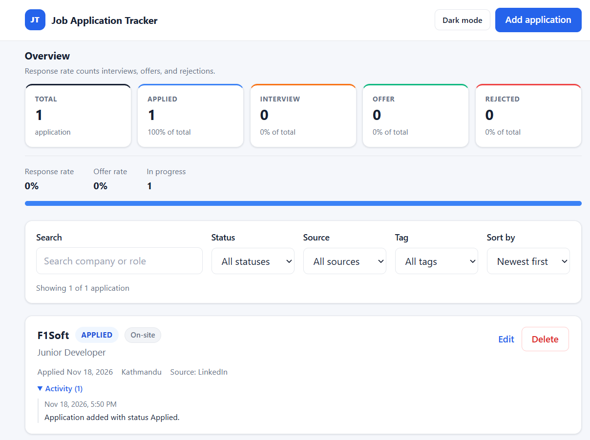
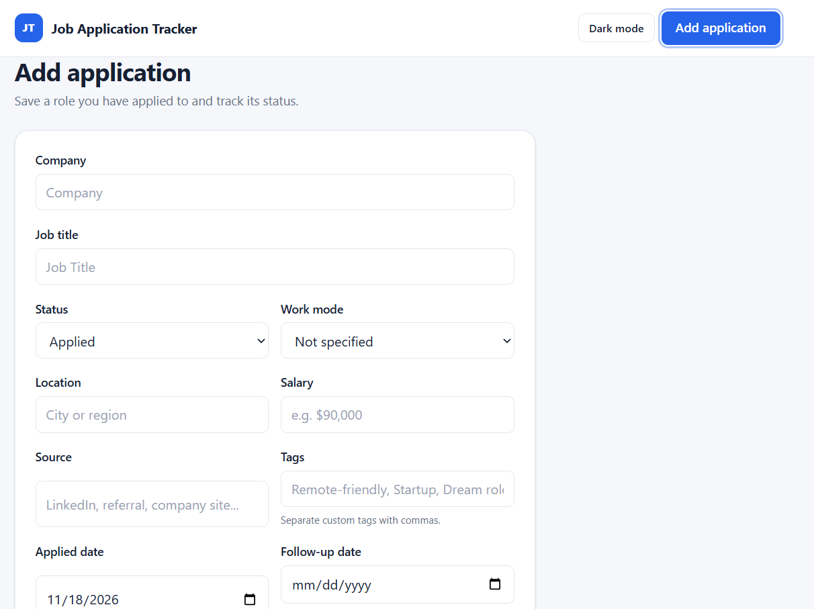

# Job Application Tracker

A tiny React app I built to keep track of the roles I’ve applied to. Add a role, paste the posting link, note the salary, where it’s located, whether it’s on‑site or remote, and any extra notes. The app saves everything in your browser’s `localStorage` – no account, no backend, no database needed. It also has a light/dark toggle and can back up your data as JSON (or a simple CSV if you just want the core fields).

## Problem

Job searching is usually a juggling act – spreadsheets, bookmarks, sticky notes, the works. This project is my attempt at a focused, client‑only tracker that answers one quick question: **which companies have I applied to, and where does each application stand?**

It is intentionally a single‑page app: open it, add applications, and the data stays in your browser.

## Features

Implemented:

- Add a job application with company, title, status, applied date, optional follow‑up date, location, work mode, salary, job posting URL, source, tags, and notes.
- Edit an existing application (the form is pre‑filled).
- Delete an application with a confirmation dialog and an undo toast.
- Track status with four values: `Applied`, `Interview`, `Offer`, `Rejected`.
- Search by company or role, filter by status, source, or tag, and sort by date or company.
- Overview with per‑status counts, response rate, offer rate, in‑progress count, and a status distribution bar.
- Follow‑up reminders for overdue and upcoming dates, plus optional browser notifications.
- Color‑coded status badges and tag chips in the application list.
- Safe external “View posting” links (only `http`/`https` URLs are rendered).
- Expandable notes and an activity timeline that logs status changes and note updates with timestamps.
- Export the full application list to a JSON backup (includes activity) or a CSV file (core fields only).
- Import JSON or CSV with validation and a confirmation before replacing current data.
- Light/dark theme toggle persisted in `localStorage`.
- Responsive layout with a shared header on every page.
- Empty states for no applications and no filter matches.
- Not‑found message for an invalid `/edit/:id` URL.
- Client‑side routing with React Router.

Not implemented (see [Tradeoffs](#tradeoffs-and-limitations)):

- Authentication or multi‑user support.
- Backend API or database.
- File uploads or attachments.
- Historical trend charts (the overview only reflects current data).
- Merging imported data with existing applications.

## Screenshots
No screenshots are committed to the repository yet. Add images under `docs/screenshots/` and replace this section with a table such as:

| Dashboard | Add application |
| :---: | :---: |
|  |  |

## Tech stack

- **React 19** with function components and hooks (`useState`, `useEffect`, `useMemo`).
- **React Router DOM 7** for client‑side routing.
- **Create React App** (`react-scripts 5`) for development and production builds.
- **Jest + React Testing Library** for tests.
- **Plain CSS with custom properties** for styling and a persisted light/dark theme (single `src/App.css`).
- **Browser `localStorage`** for persistence.

No backend, database, API, state‑management library, or charting library is used.

## Architecture

The app is a client‑side SPA. `src/index.js` mounts `App`, which owns the router. Each route is a page, and pages compose the shared form/list components. Storage and theme access are isolated in small utility modules.

```text
src/index.js
  -> App.js (BrowserRouter)
       -> Header (app shell, theme toggle, visible on every route)
       -> /          Dashboard
       -> /add       AddJob
       -> /edit/:id  EditJob

Dashboard -> StatsOverview
          -> FollowUpReminders
          -> JobToolbar -> JobList -> StatusBadge
          -> DataControls (JSON/CSV export/import)
          -> ConfirmDialog / Toast
AddJob    -> JobForm -> saveJobs()
EditJob   -> JobForm -> saveJobs()

All pages read/write through src/utils/storage.js
  -> localStorage key: "job-application-tracker"
  -> legacy records without new fields are normalized on read
Header reads/writes src/utils/theme.js
  -> localStorage key: "job-application-tracker-theme"
```

### Routes

| Route | Page | Purpose |
| --- | --- | --- |
| `/` | `Dashboard` | Stats, reminders, search/filter/sort, list, delete flow, and JSON/CSV import/export |
| `/add` | `AddJob` | Renders an empty form and appends a new application |
| `/edit/:id` | `EditJob` | Loads an application by id and updates it |

### Data model

```js
{
  id: number,
  company: string,
  title: string,
  status: "Applied" | "Interview" | "Offer" | "Rejected",
  appliedDate: "YYYY-MM-DD",
  followUpDate: "YYYY-MM-DD" | "",
  location: string,
  workMode: "On-site" | "Hybrid" | "Remote" | "",
  salary: string,
  jobUrl: string,
  source: string,
  tags: string[],
  activity: [
    {
      id: string | number,
      at: "ISO timestamp",
      message: string
    }
  ]
}
```

`id` is generated with `Date.now()` when an application is created. The full array is serialized as JSON under the `job-application-tracker` key in `localStorage`; the selected theme is stored separately under `job-application-tracker-theme`.

Records created before the new fields were added are migrated on read: `appliedDate` is derived from the id timestamp (or today’s date when that isn’t usable), and `followUpDate` defaults to empty. Unknown statuses fall back to `Applied`, invalid dates normalize to empty strings, and the newer text fields (`location`, `salary`, `jobUrl`, `source`, `notes`) plus `workMode`, `tags`, and `activity` default to empty values. Migrated records are written back the next time the list is saved.

JSON and CSV backups are validated with the same normalization logic before they are accepted. Importing a backup replaces the current list after confirmation; it does **not** merge records. CSV includes the core application fields but **does not** include the activity timeline, so JSON is the complete backup format.

### Project structure

```text
public/
  favicon.svg
  index.html
  manifest.json
src/
  App.css                # Design tokens and all component styles
  App.js                 # Router, header, and route definitions
  App.test.js            # Integration tests
  constants.js           # Statuses, work modes, source/tag suggestions
  components/
    ConfirmDialog.js     # Reusable confirmation dialog (delete/import)
    DataControls.js      # JSON/CSV export/import controls
    FollowUpReminders.js # Overdue and upcoming follow-up reminders
    Header.js            # App shell header, theme toggle, add link
    JobForm.js           # Shared create/edit form and duplicate warning
    JobList.js           # Cards, tags, activity, links, delete request
    JobToolbar.js        # Search, filter, and sort controls
    StatsOverview.js     # Status counts and rates
    StatusBadge.js       # Color‑coded status pill
    Toast.js             # Notification with optional undo action
  pages/
    Dashboard.js         # Stats, reminders, filtering, list, and data flows
    AddJob.js            # Create page
    EditJob.js           # Edit page
  utils/
    activity.js          # Timeline entries for status and note changes
    csv.js               # CSV serialization and parsing
    csv.test.js          # CSV roundtrip tests
    dates.js             # Date formatting and reminder helpers
    storage.js           # localStorage read/write, migration, normalization
    theme.js             # Theme read, apply, and persist helpers
  index.js               # React entry point
  setupTests.js          # Testing Library and polyfills
```

### Getting started

#### Prerequisites

- Node.js 20 or newer (required by React Router 7).
- npm.

#### Install and run

```bash
npm install
npm start
# or: npm run dev
```

The app runs at [http://localhost:3000](http://localhost:3000).

#### Test

```bash
npm test -- --watchAll=false
```

#### Production build

```bash
npm run build
```

The static build is written to `build/`.

### Live demo

There is no live deployment yet, and the repository does not contain hosting configuration. To deploy, build the app with `npm run build` and host the `build/` folder on any static host, with unknown paths rewritten to `index.html` so client‑side routes work.

### Testing

`src/App.test.js` contains **sixteen** integration tests that render the real app and exercise it through the UI:

1. Empty state with no applications
2. Adding an application and returning to the dashboard
3. Editing an existing application
4. Searching and filtering by status
5. Sorting by date and company
6. Status counts and response/offer rates
7. Migrating legacy records and showing overdue follow‑ups
8. Delete confirmation, cancellation, and undo
9. Persisting applications in `localStorage` across a remount
10. Invalid application id on the edit route
11. Saving additional details and rendering a safe posting link
12. Importing a JSON backup after confirmation
13. Toggling and persisting the theme
14. Logging status and note changes in the activity timeline
15. Filtering by source and tag
16. Warning when a company and title already exist

`src/utils/csv.js` adds two unit tests for CSV quoting, escaping, header normalization, and roundtrip parsing.

Because this project uses Create React App's Jest 27 with React Router 7, the test setup includes two compatibility shims:

- `package.json` maps `react-router-dom`, `react-router`, and `react-router/dom` to their CommonJS builds via Jest `moduleNameMapper`.
- `src/setupTests.js` polyfills `TextEncoder` and `TextDecoder`, which React Router 7 expects and the Jest jsdom environment does not provide.

## Tradeoffs and limitations

- **Limited data model.** Company, title, status, two dates, location, work mode, salary, a posting URL, source, tags, notes, and activity entries are stored. There are no attachments or file uploads, and salary is free text rather than a normalized number.
- **Import replaces data.** JSON and CSV imports validate and normalize records, but they replace the whole list instead of merging, and imported ids are regenerated when missing or duplicated. CSV also omits the activity timeline; use JSON for a complete backup.
- **Activity tracking is local and manual.** Timeline entries are generated only when status or notes change in this app; edits made directly in `localStorage` or older records have no history.
- **Current‑state analytics only.** The overview has counts and rates, but no historical trends or charting library.
- **Best‑effort date migration.** Legacy records get an applied date derived from their id timestamp, which may not be the real application date.
- **Reminders are in‑page.** Browser notifications require permission and only run while the page is open; there is no background scheduling.
- **Simple identifiers.** `Date.now()` is adequate for a single‑user demo but is not a robust ID strategy.
- **Styling is a single hand‑written CSS file.** It has custom properties and a light/dark theme, but no design system or component library.

## What I’d do next

- Add a backend API and database, then scope applications to authenticated users.
- Add a kanban board with drag‑and‑drop status changes.
- Support file attachments and resume versions.
- Add historical charts and trend analysis.
- Migrate to TypeScript and Vite, with Vitest for tests.
- Add end‑to‑end tests and a CI workflow that runs lint, tests, and the production build.
- Support merging imports and additional backup formats.
- Move reminders to a service worker or scheduled job for background notifications.
- Implement manual activity‑timeline entries (e.g., “met at a coffee chat”).

---
Made with ❤️ by Sumit Nyaichyai.